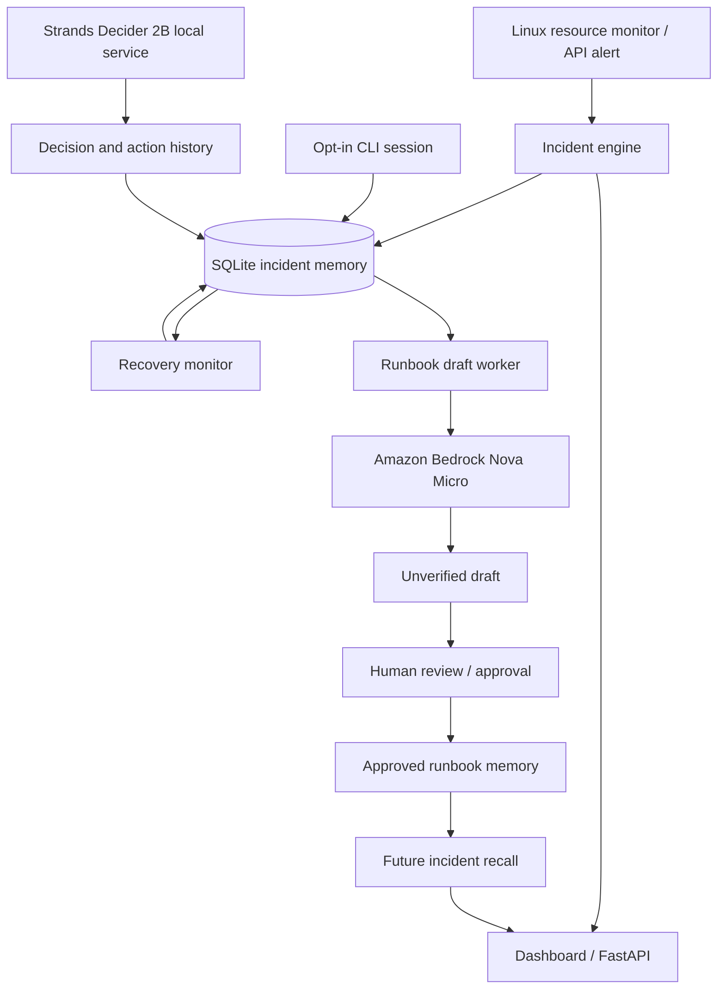

# RunbookMemory AI — Local Monitoring + Ansible API (v3)

This is a **local prototype**. Incident decisions are deterministic rules, **not Strands Decider 2B**; runbooks are templates, **not Amazon Bedrock**. Both integrations are required before hackathon submission.


# RunbookMemory AI

**Evidence-first incident memory for Linux operations, using Strands Decider 2B and Amazon Bedrock.**

RunbookMemory AI is a hackathon project exploring how an operations assistant can observe infrastructure signals, retain troubleshooting evidence, recognize recovery, and turn real incident history into reusable runbook knowledge. Its guiding principle is simple: **never mistake an AI suggestion for a verified fix.**

> **Project status (October 2026): Active prototype.** Linux resource monitoring, SQLite incident memory, persistent recovery tracking, opt-in CLI capture, a local Strands Decider 2B integration, review queues, and verified-only runbook lookup have been implemented or exercised. Amazon Bedrock integration code exists, but live generation is currently blocked by an AWS token-quota/throttling error. There is no confirmed AWS deployment or approved runbook yet. See [Implementation status](#implementation-status).

## Why it exists

During an outage, engineers investigate symptoms, run commands, and eventually restore service. Much of the useful context remains scattered across terminals and incident notes. RunbookMemory AI aims to preserve the evidence that explains *what happened, what was tried, and whether the system recovered*, then make proven procedures easier to find next time.

The intended end-to-end loop is:

1. **Detect:** Collect a Linux resource threshold event or an incoming API alert.
2. **Remember:** Store incident details and observations in SQLite.
3. **Investigate:** Route a decision through Strands Decider 2B when explicitly invoked; collect optional terminal-session evidence.
4. **Observe recovery:** Require repeated healthy resource readings before marking a monitored incident recovered.
5. **Draft:** Ask Amazon Bedrock to produce an evidence-grounded, **unverified** runbook draft only when CLI evidence and recovery are available.
6. **Review and reuse:** Keep human approval separate from recovery and recommend only approved historical runbooks for later incidents.

**Important:** These steps describe the architecture and intended workflow, not a fully hands-free pipeline. Some stages require explicit invocation, an opt-in CLI session, review, and working Bedrock access.

## Architecture



The model, Bedrock, and review components are **not** interchangeable: Strands Decider handles a bounded decision task; Bedrock is used for natural-language analysis/drafting; incident verification and runbook approval are separate evidence and governance steps.

## Technology

| Component | Technology | Purpose |
| --- | --- | --- |
| Dashboard | Streamlit | Inspect incidents, evidence, action history, drafts, and recommendations |
| API | FastAPI / Uvicorn | Receive incident events |
| Monitor | Python / psutil | Sample Linux CPU, memory, and disk metrics |
| Persistence | SQLite (WAL mode) | Incidents, observations, recovery progress, CLI sessions, decisions, and drafts |
| Decision model | `strands-decider==0.1.0` / Strands Decider 2B | Local bounded action selection when invoked |
| Generative model | Amazon Bedrock / Amazon Nova Micro | Incident analysis and runbook drafting; subject to AWS access and quota |
| AWS SDK | boto3 | Call the Bedrock Runtime API |
| Automation integration | Ansible plugin | Incident-related Ansible integration prototype |

## Implementation status

| Capability | Status / limitation |
| --- | --- |
| Linux CPU, memory, and disk monitoring | Implemented; configurable polling and threshold behavior |
| Incident recording and observations | Implemented in SQLite |
| Recovery detection | Tested with simulated CPU breach followed by three healthy samples, including a simulated monitor restart |
| Verified remediation detection | **Not implemented automatically**; recovery is not proof of which command fixed the issue |
| CLI troubleshooting capture | Opt-in `script` shell session; does **not** monitor arbitrary terminals |
| Strands Decider 2B | Actual local model inference exercised; CPU inference can be slow and memory-intensive; not automatically invoked for every new incident |
| Review task / agent action history | Implemented and exercised |
| Historical runbook recommendations | Implemented with approved-only lookup; currently no approved runbooks |
| Bedrock incident analysis / drafting | Real `converse` API integration coded; successful live generation **not yet demonstrated** due to throttling/quota |
| Automatic draft worker | Implemented polling; drafts require CLI evidence, recovered status, and working Bedrock access |
| AWS hosting | **Not yet confirmed** |
| Fully autonomous end-to-end learning | **Not yet demonstrated** |

## Repository layout

```text
runbookmemory_ai/
├── app.py                 # Streamlit dashboard
├── api.py                 # FastAPI service
├── engine.py              # Incident persistence and basic routing
├── monitor.py             # Linux sampling and recovery tracking
├── cli_watcher.py         # Opt-in troubleshooting transcript capture
├── decider_client.py      # Local Strands Decider client
├── decider_actions.py     # Decision action handlers and audit history
├── review_tasks.py        # Review queue
├── runbook_recall.py      # Approved-runbook lookup
├── runbook_drafts.py      # Evidence-grounded Bedrock draft preparation
├── draft_worker.py        # Background draft polling
├── bedrock_analysis.py    # Bedrock incident analysis
├── bedrock_status.py      # Bedrock diagnostics
├── ansible_plugins/
│   └── runbookmemory.py   # Ansible integration
├── test_recovery.py       # Isolated recovery-state regression test
├── test_bedrock.py        # Bedrock diagnostic script
├── test_bedrock_micro.py  # Nova Micro diagnostic script
├── bedrock-policy.json    # Example IAM policy (review before applying)
├── requirements.txt
└── start.sh               # Local startup script
```

Generated databases, transcripts, logs, credentials, and model weights should **not** be committed.

## Prerequisites

- Linux or Ubuntu on WSL2 (the current development/test environment).
- Python 3.12 is the known local development version.
- Enough RAM/disk for a multi-gigabyte local Strands Decider 2B model if you plan to run it. CPU inference may be slow.
- AWS credentials and Bedrock model access in `us-west-2` **only** for Bedrock features.
- Network access to download Python dependencies and model assets.

### Install

```bash
# Clone your fork or this repository
git clone https://github.com/Habieeb/runbookmemory_ai.git
cd runbookmemory_ai

python3 -m venv .venv
source .venv/bin/activate
python -m pip install --upgrade pip
python -m pip install -r requirements.txt
```

Expected direct requirements:

```text
streamlit
fastapi
uvicorn
psutil
boto3
strands-decider==0.1.0
```

> The Strands Decider package has additional transitive ML dependencies, including PyTorch and Transformers. The model weights are separate from the Python package. Refer to the package's supported setup for obtaining and serving the actual model. This README does not claim a one-command reproducible model deployment.

### Start the local application

The repository includes a convenience script:

```bash
bash start.sh
```

The local prototype has been run with:

- Streamlit dashboard: <http://localhost:8501>
- FastAPI: <http://localhost:8060>
- Local Strands Decider service, **when separately started**: `127.0.0.1:8070`

If you prefer to inspect components individually:

```bash
streamlit run app.py
# In a separate terminal, if needed:
uvicorn api:app --host 127.0.0.1 --port 8060
```

The monitor can also be started separately:

```bash
python monitor.py --interval 30
```

**Resource note:** Avoid running the multi-gigabyte Decider model unnecessarily on a memory-constrained WSL machine. Monitoring and the dashboard can be exercised without keeping the model server running.

## Walkthrough: incident to reusable knowledge

### 1. Detect and record an incident

The monitor samples CPU, memory, and disk usage. A sustained/threshold-triggering signal is recorded as an incident and linked to an observation. The API can also accept incident events; see `api.py` for the exact request schema rather than assuming an endpoint contract.

Basic initial severity and routing in `engine.py` are **deterministic heuristics**, not Strands model inference. The Decider integration is a separate path.

### 2. Capture troubleshooting evidence (opt in)

For an existing incident ID:

```bash
python cli_watcher.py start --incident 3
```

Replace `3` with the incident ID you intend to investigate. This opens a recorded shell session. Run relevant diagnostic commands, then exit the session. The saved transcript is linked to the incident.

**Privacy:** Captured terminal output may contain sensitive data. Basic redaction is not a guarantee; never type secrets or inspect confidential records in a recorded session without appropriate controls.

### 3. Detect recovery without assuming a fix

The monitor tracks which resource crossed its threshold. After **three consecutive healthy samples** for the breached resource, it records a `resource_recovery` observation and changes the incident status to `recovered`.

Recovery progress is persisted in `recovery_tracking` so the count can survive a monitor process restart. A recovered incident remains **unverified** (`verified=0`) until a separate verification process establishes that the proposed remediation was valid.

### 4. Draft with Amazon Bedrock

`runbook_drafts.py` gathers the incident, CLI transcript(s), and recovery observations. It refuses to draft if CLI evidence is missing or the incident is not marked recovered. When eligible, it calls Amazon Bedrock's `converse` API with Amazon Nova Micro and stores the response as an **unverified** draft.

The background worker in `draft_worker.py` checks eligible incidents periodically and limits retries. If Bedrock returns an error, it records/reports the failure rather than fabricating a draft.

### 5. Review and recall

The dashboard shows draft and recommendation sections. Runbook recall considers **approved** runbooks from previous incidents. Approval is distinct from recovery, and the current matching implementation is conservative but simple: it uses exact service and signal matching. It is **not** semantic similarity or environment-aware root-cause validation.

**Do not treat a suggested historical runbook as proof that it applies safely to a new incident.**

## Strands Decider 2B

This project integrates the real `StrandsAgents/strands-decider-2B-qwen3.5-v1-2610` model through a local service and `decider_client.py`. In a recorded local test, the model returned a `request_review` decision; its result was stored and a review task created. `decider_actions.py` also supports explicit `investigate` and `search_memory` actions.

The decision model is **not** claimed to be automatically running for each monitor alert. Local CPU inference may take significant time, and the model service is optional during ordinary UI/monitor development.

## Amazon Bedrock setup

The Bedrock client uses the AWS SDK for Python (`boto3`), not a Python package named `bedrock`.

```bash
aws configure --profile platform-lab-admin
aws sts get-caller-identity --profile platform-lab-admin
export AWS_PROFILE=platform-lab-admin
export AWS_DEFAULT_REGION=us-west-2
```

Replace the example profile with your own AWS profile. Never commit `~/.aws/credentials`, access keys, or `.env` files containing secrets.

The current generation code targets the **Amazon Nova Micro inference profile**:

```text
us.amazon.nova-micro-v1:0
```

Review `bedrock-policy.json` before attaching it to an IAM principal. Model access, IAM permissions, region support, and available inference quota must all be valid for a successful request. In the development account, Bedrock requests have returned `ThrottlingException` (daily token limit), so successful generation has **not** been verified.

The repository includes diagnostic scripts:

```bash
python test_bedrock_micro.py
python test_bedrock.py
```

These may invoke billable AWS APIs. Check model availability, permissions, and pricing first. A successful `GetFoundationModel` call alone does not prove that generation works.

## Tests

The isolated recovery test uses a temporary database and simulated samples; it does not modify the live incident database or call Bedrock:

```bash
python test_recovery.py
```

The verified local test covered a CPU breach, two healthy samples across a simulated restart, a third healthy sample, and the resulting transition to `recovered` while keeping `verified=0`.

Basic Python syntax validation:

```bash
python -m py_compile \
  app.py api.py engine.py monitor.py cli_watcher.py \
  decider_client.py decider_actions.py review_tasks.py \
  runbook_recall.py runbook_drafts.py draft_worker.py \
  bedrock_analysis.py
```

Syntax checks do not replace integration tests, security testing, or production validation.


## Setup (WSL)

```bash
cd ~/aws_hackerton_project/runbookmemory_local
python -m pip install -r requirements.txt
```

Open three WSL terminals (activate your Python environment in each):

```bash
python -m streamlit run app.py
```

```bash
export RBM_API_KEY='choose-a-long-random-local-key'
python -m uvicorn api:app --host 127.0.0.1 --port 8000
```

```bash
python monitor.py --interval 30
```

Streamlit: http://localhost:8501; API documentation: http://127.0.0.1:8000/docs

## Test API

```bash
curl -X POST http://127.0.0.1:8000/api/v1/events \
  -H "X-API-Key: $RBM_API_KEY" -H 'Content-Type: application/json' \
  -d '{"service":"demo-host","signal":"Ansible task failed","details":"Task: start nginx; failed because service not found","source":"ansible","event_type":"failed"}'
```

The API returns an incident ID. Refresh Streamlit > Live monitoring or Incident memory. Do not send production secrets or raw unredacted Ansible results.

## Ansible callback (controller-side)

Install Ansible separately if needed. In the shell where you run ansible-playbook:

```bash
export RBM_API_KEY='choose-a-long-random-local-key'
export RBM_API_URL='http://127.0.0.1:8000/api/v1/events'
export ANSIBLE_CALLBACK_PLUGINS="$PWD/ansible_plugins"
export ANSIBLE_CALLBACKS_ENABLED=runbookmemory
ansible-playbook -i inventory.ini your-playbook.yml
```

The callback sends only the host, task name, and failure type. It intentionally excludes task arguments and raw results because they may contain credentials. Ansible must run in the same WSL environment or the API URL must be reachable from the controller. The callback is best-effort; it does not alter Ansible task outcomes or trigger remediation. Use Ansible `no_log: true` for sensitive tasks, and avoid secrets in task names.


## Safety and operational limits

- **No automatic remediation:** The current system records, routes, drafts, and recalls; it does not establish safe automatic execution of repair commands.
- **Recovery ≠ verification:** Healthy metrics alone do not prove a particular CLI action caused recovery.
- **Review before reuse:** Generated drafts remain unverified until separately approved; approved historical procedures still require operator judgment.
- **CLI privacy:** Recorded sessions are opt-in; redaction is limited. Use sanitized demo data.
- **Secrets:** Keep AWS credentials, `.env` files, databases, logs, transcripts, and model weights out of Git.
- **Local-first:** SQLite and the local model service are prototype choices, not a production multi-tenant architecture.
- **Model availability:** Bedrock quotas, permissions, and local model resources may prevent AI stages from running.

## Hackathon context and remaining work

Built for the **Strands Decider Agent AWS Builder Hackathon**. The project demonstrates a design for bounded decision-making combined with evidence-grounded incident memory.

Before describing it as a fully deployed, end-to-end autonomous system, the following still need confirmation or implementation:

- Demonstrate a successful **real Bedrock inference** and an evidence-grounded draft.
- Verify the intended AWS deployment and document the public endpoint/architecture.
- Test a complete incident-to-reviewed-runbook-to-recall sequence with genuine, sanitized evidence.
- Improve matching beyond exact service/signal and add source-incident verification checks.
- Document reproducible Decider model startup and deployment resources.
- Add broader integration/security tests and a short demo video and AWS Builder Center write-up.

## Suggested demo sequence

1. Open the Streamlit dashboard and show recorded Linux incident observations.
2. Run the isolated recovery test to demonstrate persistent state and three-check recovery.
3. Show an opt-in CLI transcript linked to an incident.
4. Show a genuine saved Strands Decider decision and its review/action history.
5. Explain the Bedrock draft gate and, **only if live inference works**, show an actual unverified generated draft.
6. Explain that approved-only recall currently has no results until a runbook has been approved.

**Demo integrity:** Label simulations, prior recorded results, unavailable integrations, and planned capabilities clearly.


## Safety / limitations

- API listens on loopback only; use TLS, stronger identity, audit controls, and request limits before remote or production exposure.
- The API key is required for ingestion; the `/health` endpoint is unauthenticated.
- Rule-based incident classification; no real model decision trace yet.
- Monitor creates incidents for breached thresholds with a five-minute global cooldown; not production-grade alert correlation.
- Linux monitoring covers WSL, not Windows host metrics.
- The prototype stores incident evidence in a local SQLite database; keep it private and do not ingest sensitive data.


## Contributing

Issues and pull requests are welcome. Please avoid attaching real infrastructure credentials, production logs, or unsanitized terminal recordings to public issues.

## License

No project license is asserted by this README. Add an explicit `LICENSE` file if you intend to grant reuse rights. Third-party model weights and libraries have their own licensing terms.


